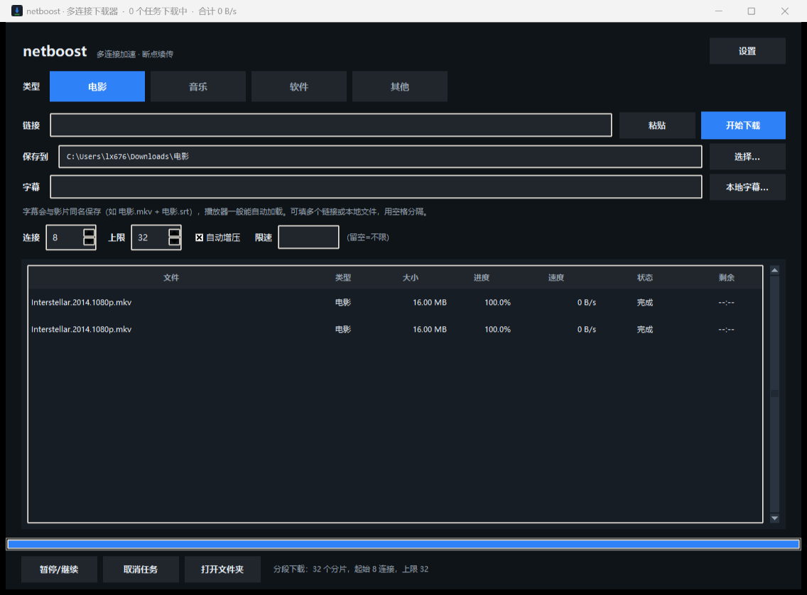
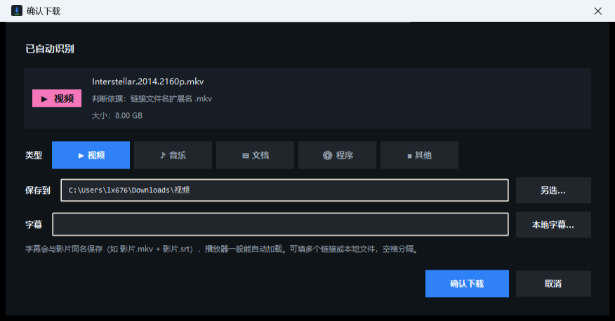
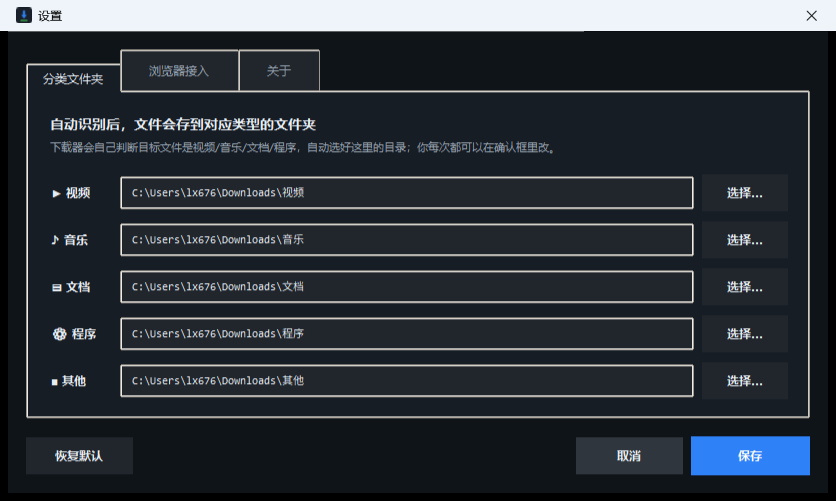
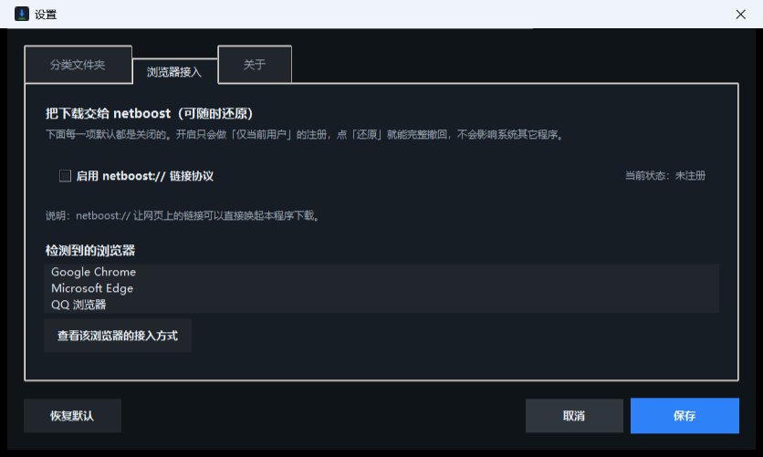

# netboost · 多连接分片下载器

> **把「单连接限速」打穿的下载器。**
> 粘贴链接 → 自动认出是什么文件 → 自动选好文件夹 → 确认即下。

[](LICENSE)
[](https://www.python.org/)
[]()
[]()

**简体中文** · [English](README.en.md)



---

## 它是什么

一个**多连接分片下载器**：把文件切成很多小块，用多个连接同时拉，最后拼成完整文件。

很多服务器 / 网盘 / 镜像站是**按单个连接**限速的（比如单连接给你 300KB/s）。这时开 N 个连接，聚合速度就能接近 N 倍，直到吃满你的物理带宽。

**它不是破解工具，也不绕过账号级限速**——详见下面的[诚实说明](#诚实说明它做不到什么)。

---

## 实测效果

本地起一个**每连接限速 256KB/s** 的服务器，下载 6MB 文件：

| 连接数 | 实测速度 | 耗时 |
|---|---|---|
| 1 | 257 KB/s | 15.9s |
| **8** | **1.53 MB/s** | **2.6s** |

**加速 6.1 倍**，下载结果 sha256 与源文件完全一致。

> 真实网络能跑多快，取决于你的**物理带宽**和服务器**单连接限速**——谁先到顶就停在哪。
> 500Mbps 宽带（约 62MB/s），只要服务器单连接给到 8MB/s 以上，默认 8 连接就能跑满。

---

## 快速开始

### 方式一：直接下 exe（免安装 Python）

到 **[Releases](https://github.com/lx67621956-create/netboost/releases)** 下载：

| 文件 | 用途 |
|---|---|
| [`netboost-gui-windows-x64.exe`](https://github.com/lx67621956-create/netboost/releases/latest) | **图形界面（推荐）**，双击即用 · 10.5 MB |
| [`netboost-cli-windows-x64.exe`](https://github.com/lx67621956-create/netboost/releases/latest) | 命令行版 · 7.5 MB |

单文件绿色版，可直接拷到别的 Windows 电脑运行。

> 首次启动会慢 1~3 秒（单文件 exe 需解压运行时），属正常现象。

### 方式二：源码运行

```bash
git clone https://github.com/lx67621956-create/netboost.git
cd netboost
python app.py          # 图形界面
python cli.py URL      # 命令行
```

只用 Python 标准库 + Tkinter，**不需要 pip install 任何东西**。

---

## 怎么用

整个流程就三步：

```
粘贴链接  →  自动识别类型  →  确认下载
```

粘贴一个 `...Interstellar.2014.2160p.mkv`，它会立刻告诉你：

> **▶ 视频** ｜ 依据：链接文件名扩展名 `.mkv`
> 保存到：`C:\Users\你\Downloads\视频`

不想改就直接回车。想改类型点一下别的分类，文件夹会立刻跟着换；想换地方点「另选…」。



### 自动识别的 5 个分类

| 类型 | 扩展名（举例） | 默认目录 |
|---|---|---|
| ▶ 视频 | mp4 mkv avi mov wmv rmvb ts… | `下载\视频` |
| ♪ 音乐 | mp3 flac wav aac m4a ogg ape… | `下载\音乐` |
| ▤ 文档 | doc docx xls xlsx ppt pptx pdf txt csv epub… | `下载\文档` |
| ⚙ 程序 | exe msi apk dmg zip rar 7z iso… | `下载\程序` |
| ■ 其他 | jpg png bin dat… | `下载\其他` |

判定顺序：**文件名扩展名 → 服务器 Content-Type → URL 路径 → 兜底**。

每个分类的文件夹在 **设置 → 分类文件夹** 里改，改一次永久生效（存在 `%APPDATA%\netboost\config.json`）。



### 视频字幕联动

识别为视频时，确认框会多出**字幕**一行，可填字幕链接（多个空格分隔）或选本地字幕文件。

下载完成后字幕**自动改成与影片同名**放同目录，播放器自动加载：

```
下载\视频\
├─ Interstellar.2014.1080p.mkv
└─ Interstellar.2014.1080p.srt      ← 播放器自动加载
```

多语言加后缀，互不覆盖：`.chs.srt` / `.eng.srt`。
自动识别 srt / ass / ssa / vtt / sub / idx / smi，**ASS 不会被误存成 SRT**。

### 命令行

```bash
# 最简单
python cli.py https://example.com/big.iso

# 指定目录 + 更多连接
python cli.py URL -o D:\Downloads -c 16 -m 64

# 限速 5MB/s
python cli.py URL --rate-limit 5M

# 批量（每行一个 URL）
python cli.py -i urls.txt -o D:\Downloads

# 机器可读输出
python cli.py URL --json
```

| 参数 | 含义 | 默认 |
|---|---|---|
| `-o, --out-dir` | 保存目录 | 当前目录 |
| `-c, --connections` | 起始连接数 | 8 |
| `-m, --max-connections` | 自动增压上限 | 32 |
| `--rate-limit` | 总限速，如 `5M` / `800K` | 不限 |
| `--no-resume` | 忽略已有进度重下 | 续传开启 |
| `--no-adaptive` | 关闭自动增压 | 开启 |
| `--referer` / `--header` | 自定义请求头 | — |
| `--insecure` | 不校验证书 | 关闭 |

---

## 特性细节

### 多连接加速
- 默认 8 连接，上限 32（可调）
- **自动增压**：每 1.5 秒采样，速度涨了就加连接；连续几次加连接不涨就停，不盲目堆连接
- 服务器不支持 Range 时自动退化为单连接，并明确提示

### 断点续传
- 边下边把每个分片进度写进 `<文件名>.netboost.json`
- 中断（关窗口 / 断网 / Ctrl+C / 取消）后重下同链接自动续传
- 续传前比对**文件总大小和 ETag**，不一致就从头下，绝不拼出坏文件

### 完整性校验
服务器 `ETag` 恰为 32 位十六进制时（不少 CDN 直接用文件 MD5 做 ETag），下载完自动算 MD5 对比，不一致会明确警告。

### 暂停 / 恢复 / 限速
- 随时暂停，状态保留，恢复后接着下
- 全局令牌桶限速，多连接共享同一速率上限

---

## 浏览器接入（可选，默认全关）

**设置 → 浏览器接入**：

- 「启用 netboost:// 链接协议」——**默认不勾**，勾选才注册，取消立即删除
- 只写 `HKEY_CURRENT_USER`，**不需要管理员权限**，不碰系统其它关联
- 自动列出已安装浏览器，可查看各自接入方式



### 关于「设为默认下载器」

必须如实说明：**Chrome、Edge、360、QQ 浏览器都是 Chromium 内核，官方并没有提供「修改默认下载器」的接口。**

任何声称能一键改掉它们的方案，本质上都是改文件关联或装扩展——副作用大、难以还原、还可能被浏览器更新重置。

所以 netboost 的做法是：
- ✅ 提供 `netboost://` 协议，网页链接可直接唤起本项目
- ✅ 复制链接 → 粘贴到 netboost
- ❌ 不硬改你的浏览器配置

**想彻底回到原样**：设置里取消勾选 → 保存，注册表项即被删除。

---

## 验证

全部实测，不是口头承诺。运行 `python tests/verify.py` 等即可复现：

| 测试文件 | 内容 | 结果 |
|---|---|---|
| `tests/verify.py` | 加速比 / 完整性 / 续传 / 退化为单连接 / 404 / 断连重试 / 暂停恢复 / 小文件 / 0 字节 / 中文名 / 限速 / MD5 | **12/12** |
| `tests/test_auto_detect.py` | 5 类识别 + 自动目录 + 协议可逆性 | **30/30** |
| `tests/test_features.py` | 分类目录 + 字幕联动 + 本地导入 | **28/28** |
| `tests/gui_e2e.py` | 驱动 GUI 真实点击下载并校验 | 通过 |
| `tests/test_exe.py` | 打包 exe 启动验证 | 通过 |
| `tests/smoke.py` | 快速冒烟（限速服务器 + 加速比） | 通过 |

```bash
python tests/verify.py            # 引擎 12 项
python tests/test_auto_detect.py  # 识别与协议 30 项
python tests/test_features.py     # 分类与字幕 28 项
```

---

## 诚实说明：它做不到什么

这部分必须说清楚，避免误解。

### ❌ 不绕过账号级限速

如果某个网盘的限速是**服务端按账号 / IP 硬卡**的（免费用户就是 100KB/s），那换什么客户端都没用——那是会员权益，不是技术问题。本工具不破解，也不打算破解。

### ❌ 没有「一键改浏览器默认下载器」

原因见上面[浏览器接入](#浏览器接入可选默认全关)一节。这是浏览器厂商的限制，不是本项目的偷懒。

### ❌ 不是 BT / 磁力客户端

没有实现 P2P 协议。

### ❌ 不是视频网站解析器

不解析、不去水印、不绕过付费墙。

### ⚠️ 别把连接数拉满

对某些小站点开 64 连接属于滥用，可能被临时封 IP。默认 8 通常够用，`-m` 上限别乱拉。

### ⚠️ 请只下载你有权下载的内容

本工具是中性技术工具，可用于下载开源软件、公开授权内容、自有服务器文件等。使用者需自行确保下载行为合法合规。

---

## 项目结构

```
netboost/
├─ core.py          下载引擎：分片、并发调度、续传、增压、限速、MD5 校验
├─ detect.py        文件类型识别（扩展名 + MIME + URL 多层判定）
├─ app.py           Tkinter 图形界面
├─ cli.py           命令行
├─ subtitle.py      字幕下载、格式探测、同名重命名
├─ browser.py       浏览器协议注册（可逆、仅当前用户）
├─ config.py        配置持久化
├─ app.ico          应用图标
├─ docs/            截图
├─ tests/           测试套件
├─ 启动.bat          双击启动 GUI（源码版）
├─ 打包exe.bat       一键打包 exe
└─ PRODUCT.md       产品简介
```

源码约 **2,400 行**，核心引擎 `core.py` 约 780 行。

### 关键实现点

- Range 请求 + `Accept-Encoding: identity`，保证分片字节精确
- 分片反复失败时自动对半切分，降低单请求压力
- 全局令牌桶实现多连接共享速率上限
- ETag 恰为 32 位 hex 时自动做 MD5 校验
- 中文文件名支持 RFC 5987（`filename*=UTF-8''...`）

---

## 自己打包 exe

```bash
pip install pyinstaller
python 打包exe.bat
```

或手动：

```bash
pyinstaller --onefile --windowed --icon app.ico --add-data "app.ico;." app.py
```

---

## 作为库使用

```python
from core import Downloader

d = Downloader("https://example.com/big.iso", out_dir="D:/Downloads",
               connections=8, max_connections=32)
d.probe()
print(d.filename, d.total, d.supports_ranges)

result = d.run(on_progress=lambda dl: print(dl.progress_line()))
print(result.path, result.avg_speed, result.md5_verified)
```

---

## 环境要求

- **Windows 10/11**（GUI 使用系统自带 Tkinter）
- **Python 3.9+**（源码运行需要；exe 版不需要）
- 无需 `pip install` 任何第三方包

核心引擎 `core.py` 跨平台，可在 Linux / macOS 上作为库使用。

---

## 许可证

[MIT](LICENSE) — 可自由使用、修改、商用，保留版权声明即可。

---

## 一句话总结

> 它不偷不抢，只是把「本该属于你的带宽」用满。
